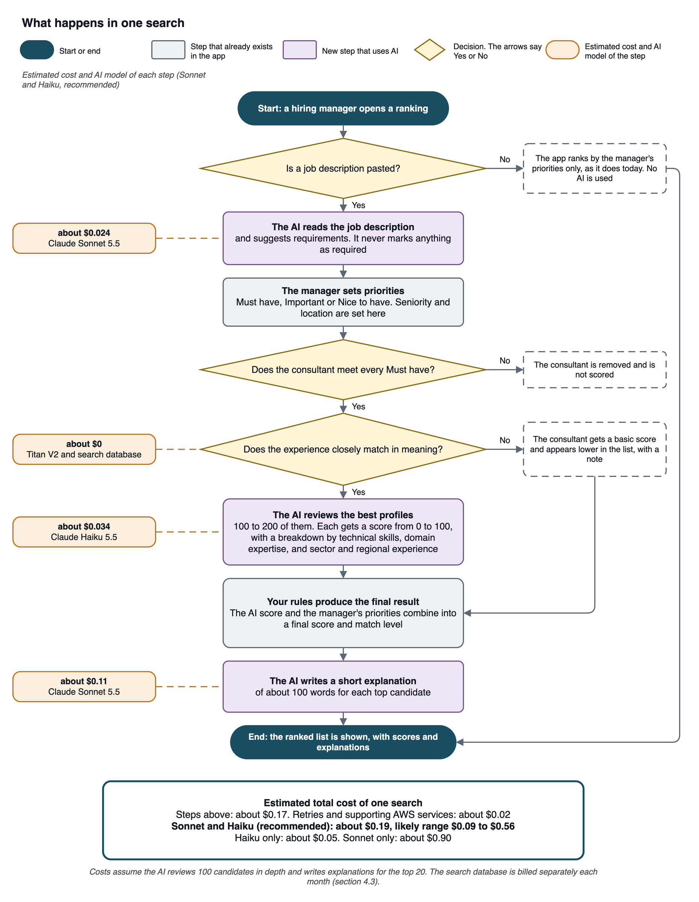
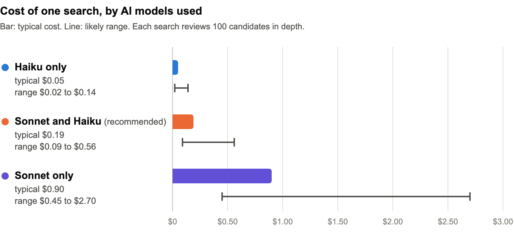
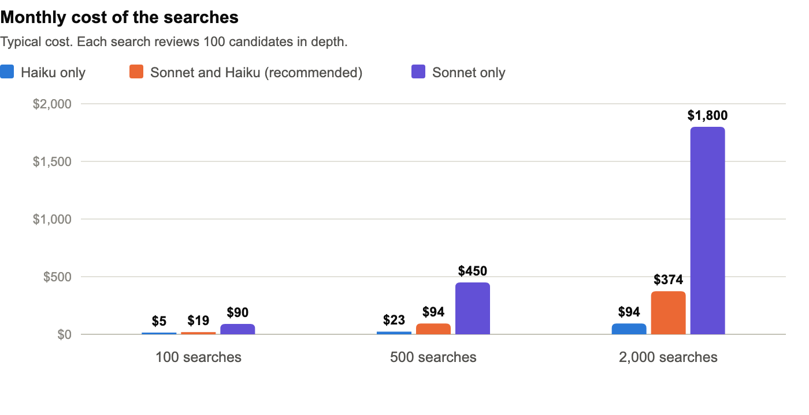
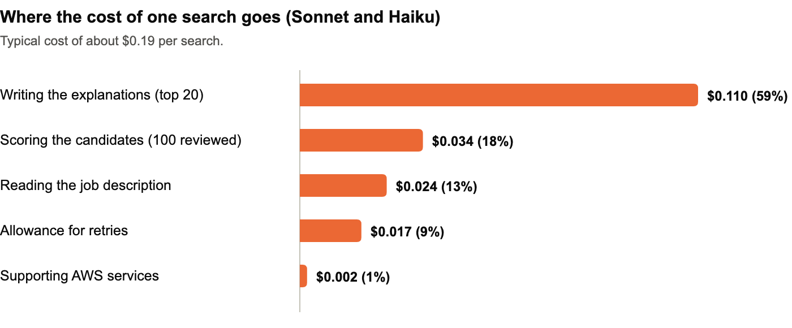

# MavenScout AI Ranking: Proposed Approach and Estimated Costs

## 1. Why we are sending this

Before building anything, we want to agree with you on how the AI ranking will work and what it will cost to run. Your ranking brief asks us to propose an approach with a cost per ranking.

This is a proof of concept. Every cost in this document is an estimate. Real costs and issues will appear when we start building. We will measure them and report them to you.

## 2. What we will build

Today the ranking compares the words in a job description with the words in each consultant's profile. It works when both use the same words. It misses consultants who describe the same experience in different words.

We will replace that part with AI that understands the meaning of a job description and of each consultant's experience, scores how well each consultant fits, and explains each result in plain language. The rest of the app does not change.

## 3. How a ranking works

*The AI is used in three steps, each with its estimated cost, and your scoring rules still decide the final result.*

Grey steps already exist in the app today. Purple steps are new and use AI. The costs shown are for the Sonnet and Haiku combination, the recommended one. Section 4 explains all three combinations of AI models.

**What each result shows.** Each ranked consultant shows a final score, a match level (Strong, Good, Partial or Weak), a breakdown of the AI score by technical skills, domain expertise, and sector and regional experience, and a short explanation of about 100 words.

**What the AI does and does not do**

| The AI does | The AI does not |
|---|---|
| Read the job description and suggest requirements | Mark any requirement as a Must have. Only the manager does that |
| Find and score consultants by their experience, from 0 to 100, with a breakdown by technical skills, domain expertise, and sector and regional experience | Judge where a consultant lives, language level, availability, seniority or past employers. Those are the manager's priorities |
| Write a short explanation for each top result | Use video or audio transcripts |
| | Favor paying members over other consultants |
| | Decide the final ranking by itself. Your existing formula does |

**If something goes wrong.** The system is designed to retry a failed step automatically. If some candidates cannot be reviewed in depth, the manager sees the results with a clear notice.

**Repeated clicks.** If a manager clicks the button again with the same job description and the same priorities, the system is designed to show the earlier result instead of running the search again, so it does not cost again. A new search runs, and costs, only when the job description or the priorities change.

**What does not change.** The screens, the scoring formula, the match levels (Strong, Good, Partial, Weak) and your rules about Must haves, membership and employers stay as they are. Any change to them would need your approval.

## 4. Estimated costs

The costs below are AWS usage fees. They are charged per use, not as a fixed fee. During the proof of concept they are billed to your AWS account. Prices come from the published AWS price lists.

### 4.1 What one search costs

A search is one ranking of candidates for one job description. The AI steps use models from Anthropic, available through Amazon Bedrock in your AWS account. Claude Haiku 5.5 is faster and costs less. Claude Sonnet 5.5 is more capable and costs more. We offer three combinations.

| AI models used | What each model does | Typical cost per search | Likely range |
|---|---|---|---|
| Claude Haiku 5.5 only | The faster, lower-cost model does every AI step | $0.05 | $0.02 to $0.14 |
| Claude Sonnet 5.5 and Claude Haiku 5.5 (recommended) | Sonnet, the more capable model, reads job descriptions and writes explanations. Haiku scores the candidates | $0.19 | $0.09 to $0.56 |
| Claude Sonnet 5.5 only | The more capable model does every AI step, including scoring each candidate | $0.90 | $0.45 to $2.70 |

In the rest of this document we call them Haiku only, Sonnet and Haiku, and Sonnet only. Finding matches by meaning uses a third model, Amazon Titan Text Embeddings V2, which adds under one cent per search in every combination.

The price of a search includes the AI models and the AWS usage of that search, plus a 10% allowance for retries. It assumes the AI reviews 100 candidates in depth and writes explanations for the top 20. It does not include the fixed monthly items in section 4.3.

*Sonnet and Haiku costs about four times Haiku only, and Sonnet only about five times Sonnet and Haiku.*

We suggest starting with Sonnet and Haiku and testing whether Haiku only is good enough. We will compare the results on your test examples before we choose.

### 4.2 What the searches cost per month

| Searches per month | Haiku only | Sonnet and Haiku (recommended) | Sonnet only |
|---|---|---|---|
| 100 | $5 | $19 | $90 |
| 500 | $23 | $94 | $450 |
| 2,000 | $94 | $374 | $1,800 |

These monthly figures are the cost of the searches only. They do not include the fixed monthly items in section 4.3. They show what continued use after the proof of concept would cost. The proof of concept environment is temporary, so moving to production would need a separate agreement.

*The monthly cost is the number of searches times the cost of one search, so the option you choose matters most at high volumes.*

### 4.3 Other costs

These items are not included in the price of a search.

| Item | When | Amount | Note |
|---|---|---|---|
| Preparing the consultant profiles for search | One time | Under $1 | About 3,000 profiles. Repeated only for profiles that change |
| Search database | Monthly | About $5 to $100 | Estimate. It charges only while it is used, from about $5 at 100 searches to about $100 at 2,000 |
| Supporting AWS services (storage, scheduling, monitoring, alerts) | Monthly | About $5 or less | Estimate |
| Testing during the proof of concept | One time | Under $60 | About 250 test searches, including the search database |
| Candidate profile database | None extra | $0 | We use your existing Supabase project. Its plan may need a check |

The search database is where the system stores the meaning of each consultant profile so it can find matches.

### 4.4 What changes the cost

For Sonnet and Haiku, writing the explanations is the largest part of the cost.

*Writing the explanations is about 59% of the cost, so it is the easiest part to adjust.*

1. The number of searches per month.
2. Repeating the same search. If the job description and the priorities are the same, the system is designed to reuse the earlier result, so it does not cost again.
3. How many candidates the AI reviews in depth. With 200 instead of 100, Sonnet and Haiku goes from about $0.19 to about $0.22 per search.
4. How many explanations are written. Writing them for the top 10 instead of the top 20 lowers Sonnet and Haiku from about $0.19 to about $0.13 per search.
5. Which AI model is used at each step.
6. Reviewing every profile with AI would cost about $1 per search with the fastest model and about $23 with the most capable one, and it would take longer. That is why the system first narrows the candidates by meaning and then reviews only the best ones.

### 4.5 How reliable these numbers are

These costs are estimates. We have not measured any real search yet, and we expect real costs to land between about half and three times the typical figures above. We will measure the cost on the first test searches and report the measured cost per search at the end of the proof of concept.

## 5. What we need from you

We ask you to review the flow in section 3 and the cost estimates in section 4, and to answer these questions.

1. How long can a manager wait for a result? We estimate 1 to 2 minutes. A shorter wait means fewer candidates reviewed in depth.
2. Your approval to enable the AI models in your AWS account. The account does not have AI model access enabled yet, and the usage limits for the AI models are currently set to zero. Enabling them needs a one-time access form and a request to raise the limits. The AI models are provided by Anthropic and billed through AWS Marketplace. Requests are processed in AWS regions in the United States.
3. Confirmation of the score breakdown. We propose that the AI provides technical skills, domain expertise, and sector and regional experience, and that seniority and location come from the manager's priorities, because your ranking rules keep them separate from the AI judgment. Is this acceptable?

## 6. What we do not know yet

1. The real cost per search. The figures above are estimates.
2. How long a search takes. 1 to 2 minutes is an estimate.
3. How much better the AI ranking is than today's. We will test it on your existing test examples and on harder ones, where consultants describe their work in different words than the job description, as your brief suggests. We will share the results before and after.
4. How the system behaves with about 3,000 real profiles. Today the test data has 98 sample profiles.
5. Whether the AI scores spread across the match levels as you expect. We may propose adjusting the match level thresholds based on the results. Any change needs your approval.

## 7. Next steps

1. You review this document and answer the questions in section 5.
2. With your approval and alignment, we enable the AI models and confirm the usage limits in your AWS account.
3. We then start building the infrastructure and everything needed to put the flow in section 3 into practice.
4. We send you updated figures and, at the end, the measured cost per search.
