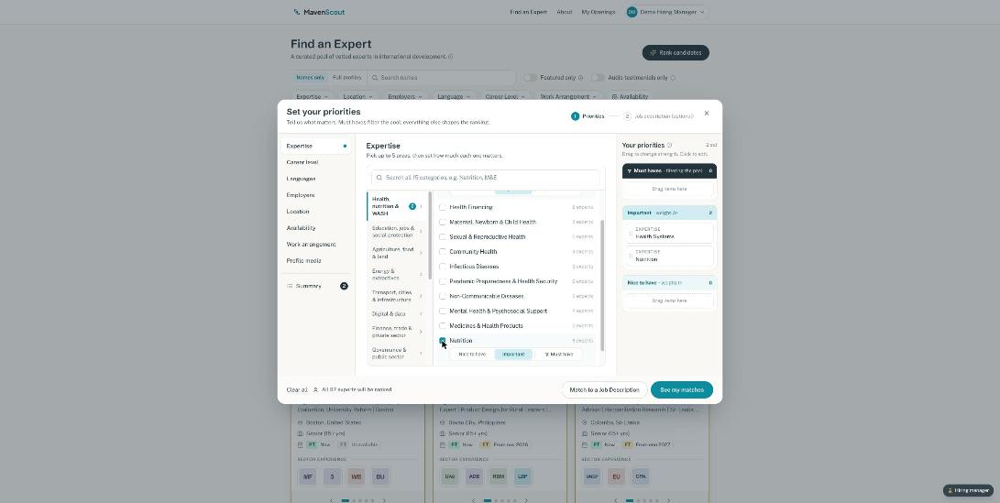
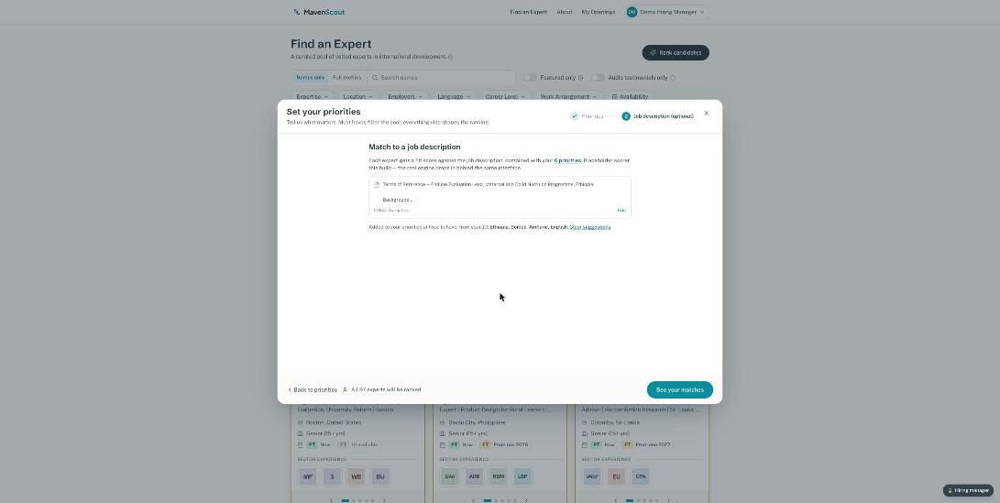
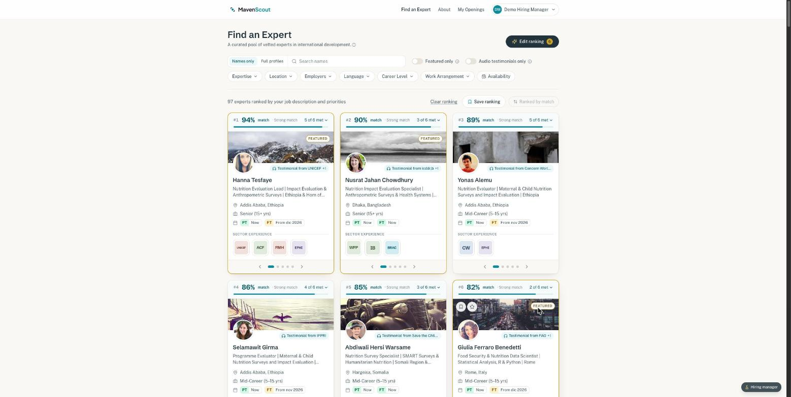
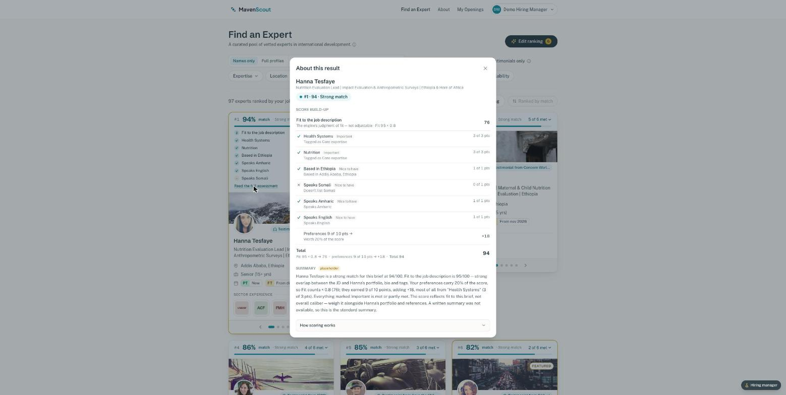

# First real runs of the ranking engine in the customer account

| | |
|---|---|
| Status | Complete for the runs of 2026-11-21. One job description, one model, one pool |
| Phase | P2 (engine wiring and first measurements) |
| Task | Run the semantic engine (variant A) in AWS for the first time, from the API and from the customer's app, and record what it did, how long it took, what it cost and what is still wrong |
| Owner | Guillermo Sandoval |
| Date | 2026-11-21 |
| Sources | The evidence folder `loop8/evidences/poc/2026-11-21/` (every figure below names its log), the job records and results in the POC account, CloudWatch, Cost Explorer and the AWS Price List API, `loop8/docs/planning/worker-engine-connect-plan.md`, `loop8/docs/planning/engine-hardening-plan.md`, the engine blueprint |

Everything in this report was measured on 2026-11-21 unless it says estimate. A figure that comes from a price list and not from a bill is called computed. Figures that the engineers reported and that were not measured here say reported by the engineer.

## 1. Summary

1. The semantic engine runs in the customer account. A ranking of 98 candidates finishes in 10.7 to 13.5 seconds, calls Nova Lite once per candidate, and costs about 0.008 dollars (computed from measured tokens). The customer's target is 10 to 30 seconds.
2. Five real jobs ran: three posted to the API and two started from the customer's app on the project lead's machine. The last three finished DONE with every candidate ranked. The first two finished PARTIAL because the index left some profiles out, which was found and fixed the same day.
3. On the sample job description (ToR 01) the three profiles that the test fixture expects at the top ranked first, second and fifth. This is one job description and a synthetic pool, so it shows that the path works and not that the ranking is better than the manual one.
4. There was no throttle, no retry, no server error and no failed Fit call in any of the five jobs. The dead letter queue stayed empty and no alarm fired.
5. Four things are not good yet. The written summaries all fell back to the template text in these jobs and still cost about 9.5 percent of each job. A fix (pull request 79) was accepted on 38 of 40 summaries in a live check, and it is not deployed. The index text carries organization names in 40 of 98 profiles, the Fit scale is coarse and changes by 10 points for 3 to 6 percent of the candidates between repeats, and the engine does not read job descriptions with a model yet.
6. The cost of the process this month is dominated by the AWS support plan, 29.00 dollars of 29.36 dollars. The Bedrock spend of the project to 2026-11-20 is 0.25 dollars.

## 2. What was built and deployed

The engine runs as a queue and a worker in the customer's temporary POC environment. The run of 2026-11-21 added the pieces below. The full inventory is in the runbook `loop8/docs/runbooks/poc-environment.md`.

| Piece | State on 2026-11-21 | Source |
|---|---|---|
| API Gateway HTTP API with `POST /jobs` and `GET /jobs/{id}`, throttled, CORS limited to the app origins | Active, no authentication (accepted risk of the blueprint) | `aws-state.log` P7 |
| Api Lambda (10 s) and worker Lambda (180 s, 1,024 MB, Node 22) | Active | `aws-state.log` P1, P2 |
| Jobs queue with a dead letter queue after 5 receives | Dead letter queue empty | `aws-state.log` P5 |
| Jobs table and jobs bucket | Inputs and results expire after 7 days, the index does not | `aws-state.log` P3 |
| Worker settings | `ENGINE=semantic`, index `index/index-13d7674312434864.json.gz`, Supabase values read from Secrets Manager | `aws-state.log` P1 |
| Model settings given to every job | Fit and text: Nova Lite through the `us.` inference profile. Embeddings: Titan Text Embeddings V2 | `aws-state.log` P2 |
| Model call limits (pull request 68) | 25 second request timeout, 5 retries with an 8 second cap, run deadline from the Lambda time, fewer parallel calls after a throttle | `engine-hardening-plan.md` |
| Alarms | 17 alarms of the engine, all in OK | `aws-state.log` P6 |

Pull requests 55 to 72 are merged into `loop8-develop` and nothing was merged into `main`. Every apply deployed with 0 resources destroyed. Two pipeline runs failed: the one of pull request 40 (tagging permissions of the apply role) and the one of pull request 60 (the engine build did not find the app dependencies in CI). Both were fixed by later pull requests (`pipeline.log` P1 to P3).

## 3. Test setup

| Item | Value |
|---|---|
| Job description | `docs/samples/tor-01-ethiopia-nutrition.txt`, 2,955 characters, an endline evaluation lead for a nutrition programme in Ethiopia |
| Requirement rows through the API | The 9 fixed rows of the sample in `docs/samples/expectations.json` (two expertise rows at Important, three at Nice to have, English as a Must have, Amharic or Somali at Important, Ethiopia and Senior at Nice to have) |
| Requirement rows in the app | Health Systems and Nutrition at Important, plus the places and languages the app read from the text (Ethiopia, Somali, Amharic, English) at Nice to have |
| Pool | The 98 approved and active individuals of the customer database. The app shows 97 of them. The first API job also included the 23 firms, which the app hides |
| Index | 98 local demo profiles, 964 fragments, embedded with Titan V2. First version `bda903154e95230e`, current version `13d7674312434864` |
| Settings of every job | `FIT_CAP` 200, `SUMMARY_COUNT` 5, `PARALLEL_CALLS` 16, no similarity threshold |
| Models | Nova Lite for Fit and for the summaries. Nova Lite is temporary, because GPT-6 Luna and Sol and Claude Haiku and Sonnet 5.5 are not enabled for the account |
| Prompt versions | `fit-v2` and `summary-v1` |

The pool is synthetic demo data and the sample job description is the customer's own sample. The three profiles that the fixture expects for ToR 01 are Hanna Tesfaye, Nusrat Jahan Chowdhury and Abdiwali Hersi Warsame.

## 4. The five jobs

| Job | Started from | Pool | Index | State | Ranked | End to end | Fit calls | Nova Lite tokens in and out | Computed cost |
|---|---|---|---|---|---|---|---|---|---|
| API-1 | API | 121 | first | PARTIAL | 92 | 13.4 s | 92 | 106,786 and 4,471 | 0.0075 USD |
| UI-1 | App | 97 | first | PARTIAL | 91 | 13.2 s | 91 | 105,150 and 4,558 | 0.0074 USD |
| API-2 | API | 98 | current | DONE | 98 | 13.5 s | 98 | 114,080 and 4,653 | 0.0080 USD |
| UI-2 | App | 97 | current | DONE | 97 | 13.5 s | 97 | 112,424 and 4,696 | 0.0079 USD |
| API-3 | API | 98 | current | DONE | 98 | 10.7 s | 98 | 114,080 and 4,661 | 0.0080 USD |
| Total | | | | | | | | 552,520 and 23,039 | 0.0387 USD |

Source: `job-records.log` P1. The two PARTIAL jobs left out the profiles the index did not cover under their database id: 29 in API-1 (23 firms and 6 individuals) and 6 in UI-1. The six individuals are the ToR 05 test profiles, which the demo seed gives a slug and no id. The index keyed them by slug, while the database holds them under an id derived from `demo-<slug>`. The six derived ids matched the six `not_indexed` ids of the first job exactly, the index was rebuilt with no new embedding (all 964 vectors reused), and the later jobs have no `not_indexed` profile (`index-build.log` P2 and P3, pull request 72).

## 5. Quality

### 5.1 What the ranking looked like

For API-3, the top ten were:

| Rank | Profile | Fit | Total | Band |
|---|---|---|---|---|
| 1 | Hanna Tesfaye | 95 | 95 | strong |
| 2 | Nusrat Jahan Chowdhury | 95 | 90 | strong |
| 3 | Yonas Alemu | 90 | 90 | strong |
| 4 | Selamawit Girma | 90 | 88 | strong |
| 5 | Abdiwali Hersi Warsame | 90 | 86 | strong |
| 6 | Beatriz Nogueira Lima | 90 | 83 | strong |
| 7 | Giulia Ferraro Benedetti | 90 | 80 | strong |
| 8 | Pablo Vargas | 85 | 75 | good |
| 9 | Dr. Sunita Patel | 80 | 75 | good |
| 10 | Hiba Osman Elfaki | 80 | 68 | good |

Source: `api-run-3.log`. The three expected profiles are at ranks 1, 2 and 5. In the app, with other priorities (two expertise rows at Important and the places and languages at Nice to have), the top five were the same five profiles in the same order (`ui-run-screenshots/03-ranking-97-experts.jpg`).

### 5.2 How the Fit scores are spread

Across the 98 candidates of API-3 the Fit scores were: 95 for 2, 90 for 5, 85 for 1, 80 for 2, 70 for 2, 60 for 2, 40 for 3, 30 for 7, 20 for 40, 10 for 23 and 0 for 11. By band, 7 are strong, 3 good, 4 partial and 84 weak (`job-records.log` P1).

1. The scale is coarse. Nova Lite answers in steps of 5 and 10, so five candidates share a Fit of 90 and the order among them comes from the preference share. The bands are the customer's thresholds (80, 65, 50), and this distribution puts most of the pool in the weak band for this job description.
2. Whether this is the right spread for the customer is a decision, because the band thresholds are proposed from our own baseline runs and need sign-off.

### 5.3 Repeats and pool independence

Fit is judged for one candidate at a time, so a candidate's Fit cannot depend on the rest of the pool by design. The runs let this be checked:

| Comparison | Candidates in common | Same Fit | Different | Size of the difference |
|---|---|---|---|---|
| API-2 and API-3, same pool repeated | 98 | 95 | 3 | 10 points each |
| API-3 (98 pool) and UI-2 (97 pool, other priorities) | 97 | 91 | 6 | 10 points each |
| API-3 and API-1 (121 pool with firms, first index) | 92 | 86 | 6 | 5 to 10 points |
| UI-2 and UI-1 (before and after the index fix) | 91 | 87 | 4 | 5 to 10 points |

Source: `job-records.log` P1. The top 10 of API-2 and API-3 are identical, and the top 5 of API-3 and UI-2 are identical.

The model is called with temperature 0 and still changes its Fit for 3 to 6 percent of the candidates between runs, by one step. This is model noise and not pool dependence, but it is a real limit: a candidate near a band edge can change band between two identical searches. Four repeats are too few to say more. A proper measure needs many repeats of several job descriptions.

### 5.4 Against the manual ranking

This report did not run the manual against AI comparison. The engineer reported on 2026-11-20 the results of `npm run compare` with Nova models (reported by the engineer, one run per setup, small samples, and the hard cases are the project's own):

1. On the customer's five ToRs the AI and the keyword scorer tie, both with 14 of 14 expected profiles in the top 5.
2. On four hard cases, where the right work is described in different words, the keyword scorer places 1 of 4 in the top 10, Nova Lite 3 of 4 and Nova 2 Lite 4 of 4.
3. A cap of 200 against a cap of 20 made no difference in the top 10 on those pools.

The customer asked on 2026-11-16 to see that the AI ranking is better and not only different. These results support that for vocabulary mismatch cases and show a tie on the customer's own ToRs, whose profiles use the same words as the job descriptions.

## 6. Performance

The phase times below are from the job records (`job-records.log` P1).

| Phase | API-3, warm container | Range over the five jobs |
|---|---|---|
| Embed the query (Titan) | 0.12 s | 0.12 to 0.20 s |
| Vector search in memory | 0.003 s | 0.003 to 0.006 s |
| Fit (98 calls, 16 at a time) | 4.4 s | 4.3 to 4.8 s |
| Scoring | 0.02 s | 0.02 to 0.03 s |
| Summaries (5, each tried twice) | 2.4 s | 2.3 to 2.7 s |
| Sum of the phases | 7.0 s | 7.0 to 7.4 s |
| End to end, from the POST to DONE | 10.7 s | 10.7 to 13.5 s |

1. About 3.8 seconds of the warm job and up to 6.2 seconds of the slower ones fall outside the engine phases. That time covers the queue, the Lambda start, reading the 9.4 MB index when the engine is built on a new container, reading the profile data and the reference lists from the customer database, writing the checkpoints and the result, and the polling interval of 1 to 1.5 seconds. It was not broken down further.
2. The Fit calls ran at about 1,340 requests per minute for four seconds, well above the 400 requests per minute quota of Nova Lite, and Bedrock reported no throttle (CloudWatch `InvocationThrottles` 0). The quota is a rate, and a short burst did not hit it. A longer burst might.
3. The first 5 summaries run after the ranking, as the blueprint says. They add about 2.5 seconds and all fall back.
4. The blueprint's estimate was 1 to 2 minutes for 100 to 200 model calls. The measured time is under 14 seconds for 98 calls.

## 7. Cost

### 7.1 Prices used

Source: AWS Price List API, service `AmazonBedrock`, region us-east-1, on demand, read on 2026-11-21 (`cost-measurement.log` P1 and P2).

| Item | Price |
|---|---|
| Nova Lite input | 0.00006 USD per 1,000 tokens (sku QRGWJ3P8FT28EYX2) |
| Nova Lite output | 0.00024 USD per 1,000 tokens (sku CBZ6A6U7XK8WJ3KA) |
| Titan Text Embeddings V2 input | 0.00002 USD per 1,000 tokens (sku EDNQYEHQ3XQ8N7EY) |

The jobs call Nova Lite through the `us.` cross region inference profile. The price list has no separate line for the profile, so the figures below assume the source region price. If the profile adds a premium, the costs rise by that share. Cost Explorer for 2026-11-21 was not available yet to confirm it.

### 7.2 Cost of one ranking

Measured tokens, computed cost, API-3 (98 candidates):

| Part | Calls | Tokens in | Tokens out | Computed cost |
|---|---|---|---|---|
| Fit, one call per candidate | 98 | 105,470 | 3,654 | 0.0072 USD |
| Summaries, 5 candidates, each tried twice | 10 | 8,610 | 1,007 | 0.0008 USD |
| Query embedding, one call | 1 | about 740 (estimate from the text size) | none | under 0.00002 USD |
| Total | | 114,080 | 4,661 | 0.0080 USD |

1. A Fit call used about 1,076 input tokens and 37 output tokens, which is 0.0000735 USD per candidate.
2. The summaries are about 9.5 percent of the cost of a job and produce no usable text, because every summary fails the 40 to 60 word rule and falls back. The CloudWatch invocation count shows why: 527 invocations for the five jobs, which is 476 Fit calls, 50 summary calls (5 summaries, 2 tries, 5 jobs) and one test call.
3. The blueprint estimated 0.04 dollars per ranking with a small model, with Claude reference prices (estimate). The measured cost with Nova Lite is about five times lower.

### 7.3 Estimates beyond what was measured

These are estimates and nobody measured them in this account.

| Case | Estimate | Basis |
|---|---|---|
| Ranking of a pool of 3,000 with a shortlist at the cap of 200 candidates | About 0.016 USD | 200 Fit calls at 0.0000735 plus the summaries, same tokens per candidate |
| A ranking of 98 candidates with Nova 2 Lite instead of Nova Lite | About 0.05 USD | The tokens of API-3 at rates derived from the Cost Explorer lines of 2026-11-20: input 0.00033 and output 0.00275 USD per 1,000 tokens, which is 5.5 and 11 times Nova Lite. Nova 2 Lite may use other token counts |
| 10 rankings in a month by one hiring manager (the monthly cap discussed with the customer) | About 0.08 USD with Nova Lite | 10 times the measured cost of a job |
| Indexing 3,000 profiles | About 0.03 USD | The 964 fragments of 98 profiles cost 42,765 tokens, so 3,000 profiles are about 30 times that |

### 7.4 Cost of the process so far

| Item | Amount | Source |
|---|---|---|
| Index build, Titan V2, 964 embeddings, 42,765 input tokens | 0.0009 USD (computed) | `index-build.log` P1 |
| The five jobs of 2026-11-21, Nova Lite | 0.0387 USD (computed from the measured tokens) | `job-records.log` P1 |
| CloudWatch token counts for 2026-11-21 | Equal to the job records of the five jobs plus one 11 token test call: input 552,528 against 552,520 plus 8, output 23,042 against 23,039 plus 3 | `cost-measurement.log` P3 |
| Bedrock spend of 2026-11-20 in Cost Explorer: Nova 2 Lite 0.19, Nova Lite 0.04, Nova Pro 0.01, Titan 0.001 | 0.25 USD (billed) | `cost-measurement.log` P5 |
| Bedrock spend of November to 2026-11-20 | 0.2487 USD (billed) | `cost-measurement.log` P4 |
| AWS Business Support+ plan, November | 29.00 USD (billed, the plan of the account, not caused by the engine) | `cost-measurement.log` P4 |
| All AWS services, November to date | 29.36 USD (billed) | `cost-measurement.log` P4 |

1. The Bedrock spend of 2026-11-20 is the engineers' comparison runs and tests, which the engineer reported as about 0.20 dollars. The billed figure is 0.25 dollars.
2. The jobs of 2026-11-21 are not in Cost Explorer yet, because its data lags. They add about 0.04 dollars to the Bedrock figure.
3. The monthly budget of the POC is 350 dollars with alerts and actions. The 29.36 dollars to date are 8.4 percent of it, and 29.00 of them are the support plan.
4. The idle cost of the engine is small. The 17 alarms are about 1.70 dollars a month (estimate at 0.10 dollars each) and the secret is about 0.40 dollars a month. The queue, the table, the bucket, the Lambdas and the API cost cents at this volume. Cost Explorer shows Secrets Manager at 0.03, S3 at 0.003 and DynamoDB at 0.0006 dollars for the month to date.
5. Each Cost Explorer query costs 0.01 dollars. The 0.07 dollars the service shows for the month include the queries made for the checks of this project.

## 8. Reliability and error handling

1. No job had a throttle, a retry, a server error or a failed Fit call, and CloudWatch shows no client or server error for the model (`cost-measurement.log` P3).
2. The model call limits of pull request 68 are deployed: a 25 second request timeout, retries of the transient errors with an 8 second cap, a run deadline taken from the Lambda time, and fewer parallel calls after a throttle. The timeout was checked with a real call: the same call with a 1 millisecond timeout failed with `RequestTimeout` after 9 milliseconds, and the normal call answered in 0.9 seconds (`engine-hardening-plan.md`, section 8).
3. Not exercised: a real throttling burst, a real hung call, the run deadline in a live run, the dead letter queue path and the resume after a crash. They are tested with injected errors and a moving clock in the engine tests (382 tests when the pull request was merged), not against the account.
4. Every failure that did happen was in the delivery, not in a job: the apply of pull request 60 failed in the engine build, and the checks of pull request 70 failed twice on the Checkov rule CKV_AWS_300 before the lifecycle rules were rewritten. Both were fixed (`pipeline.log` P2).

## 9. Findings

| # | Finding | Evidence | State |
|---|---|---|---|
| 1 | The written summaries all fall back to the template. Nova Lite writes 74 to 77 words against the 40 to 60 required, so the length check fails and the retry fails too, and the job still pays for both tries | `job-records.log` P1, `ui-run-screenshots/04-score-breakdown-first-candidate.jpg` (the summary is marked placeholder) | Fixed in pull request 79: prompt `summary-v2` with the writing rules, a check for dashes and lists, and a retry that cuts or extends the rejected text. A live check on 40 real candidates accepted 38 and none had a dash (`summary-live-check.log`). Open until it is merged and deployed |
| 2 | The index text carries organization names: 153 hits in 40 of the 98 profiles (bio 76, portfolio 38, tagline 24, work history 15). Fit is told to ignore employer names and nothing removes them | `check-artifact.log` P1 and P2 | Known limitation 3 of the engine README. Decision needed: clean the text before indexing or accept it |
| 3 | Six individuals were missing from every ranking | `index-build.log`, `job-records.log` | Fixed in pull request 72 |
| 4 | Fit is coarse and moves by one step for 3 to 6 percent of the candidates between repeats | Section 5.3 | Open. Needs a repeat study |
| 5 | The template text of the narrative, in the customer's `src/lib/matching/narrative.ts`, contains an em dash | `ui-run-screenshots/04-score-breakdown-first-candidate.jpg` | Not ours to change without the customer. The summary prompt can follow the writing rules, see the open items |
| 6 | The API has no authentication and the sign in of the app is mocked | `aws-state.log` P7 | Accepted risk of the blueprint, to be stated to the customer |
| 7 | A ranking from the app writes to the customer database. It replaced the earlier ad hoc ranking of the demo manager, and left the ranking saved in an opening untouched | `ui-run.log` P2 | By design of the app. Tell the customer before any demo on the shared database |
| 8 | A new index is read only when the worker starts a new container. A key changed in Terraform replaces the environment and forces it | `aws-state.log` P1 | Handled with versioned index keys |
| 9 | Typing the 2,955 character text into the app one key at a time froze the browser tab. Setting the text in one step worked | `ui-run.log` P1 | A note for the test method, not a product defect |

## 10. Deviations from the engine blueprint

The blueprint is the published page `loop8/docs/architecture/index.html`. The build differs from it in these places. The project lead decides which are accepted, and the blueprint is updated for those.

| # | Blueprint | Build | Reason | What would remove it |
|---|---|---|---|---|
| 1 | When time runs short the worker saves a checkpoint and sends a continuation message | The run stops starting calls early and finishes with flagged estimates | Simpler, and a job is never lost | Checkpoints per candidate, `sqs:SendMessage` for the worker role, a continuation message |
| 2 | After a throttle the job halves its parallelism and recovers slowly. A last pass retries the failed candidates | The parallelism is halved down to 2 and is not raised again in the run. No last pass | Less code for a first version | A slow recovery rule and a retry pass |
| 3 | 4 attempts and a 30 second call timeout | 6 attempts and a 25 second timeout | Gap 3 of the engine review asked for a longer retry | Change the blueprint, or change the defaults |
| 4 | A checkpoint after each candidate | One checkpoint per candidate at the end, in rank order | The summaries need every total first | Write the Fit results as they arrive and update them after the summaries |
| 5 | OpenSearch Serverless as the vector database | An index file in S3, searched in memory | Variant A with a pool of 98 profiles, and OpenSearch bills by the hour | The OpenSearch build check and a decision on its cost to the customer |
| 6 | A model reads the job description and suggests requirements | The engine uses the app's current extractor. The manual against AI comparison gives both sides the same extraction | The first variant measures Fit | An extraction call with the text model, which the customer's suggested priorities need |
| 7 | Summaries on demand and reuse of a stored result by hash | Not built | Both are optional in the blueprint | A route `POST /jobs/{id}/summaries`, a button in the app, and a hash of the request |

## 11. The points agreed with the customer

| # | Point | State |
|---|---|---|
| 1 | Variants: start with the small model alone and 5 summaries | Variant A is built and measured. The small model is Nova Lite, temporarily, because the agreed models are not enabled for the account. The customer must be told before the review |
| 2 | Summaries of 40 to 60 words, 5 by default | The count and the length rule are built. The text falls back until pull request 79 is merged. The on demand button is not built |
| 3 | A similarity threshold to try | The setting exists and is off. No value was tried. The cap of 200 against 20 made no difference on the engineer's pools |
| 4 | The AI may suggest Important and Must have | Not built. It needs the extraction call and a rule recorded with the customer |
| 5 | A monthly cap per hiring manager | Not built. The manager id already travels in the request |
| 6 | Expertise read as text, profile form unchanged | Done. The index holds one fragment of expertise tags as text for each of the 98 profiles, and the form did not change |

## 12. Open items

1. Merge pull request 79, the summary fix with the writing rules (plain words, like one person explaining to another, no analogies, no lists, no dashes used as punctuation) and a code check with feedback on the retry, apply it, and rank again from the app to read the real summaries.
2. Decide on the organization names in the index text.
3. Tell the customer, through the project manager, that the review uses Nova Lite and not the models agreed on 2026-11-16, and that a ranking from the app replaces the demo manager's ad hoc ranking.
4. Wait for AWS to enable Luna, Sol, Haiku and Sonnet 5.5 (support case and sales form sent), then repeat the five jobs and the comparison with them.
5. Measure the repeat noise of Fit with many repeats, and propose the band thresholds from the results.
6. Try a few similarity thresholds and measure time, cost and which expected profiles stay.
7. Decide on the deviations of section 10, and on the extraction call and the monthly cap.

## 13. How to repeat the runs

```bash
# The index (needs the Titan role). Output: loop8/internal/index-artifact.json
loop8/engine/node_modules/.bin/esbuild loop8/engine/scripts/build-index.ts --bundle --platform=node \
  --format=esm --packages=external --outfile=loop8/engine/.local-dist/build-index.mjs
node loop8/engine/.local-dist/build-index.mjs
gzip -c loop8/internal/index-artifact.json > index.json.gz   # upload under index/index-<version>.json.gz, then set index_artifact_key

# One job through the API (reads the pool from the customer database, read only)
ENGINE_URL=<api base url> SUPABASE_URL=<url> SUPABASE_ANON_KEY=<key> node loop8/evidences/poc/2026-11-21/real-job.mjs

# The records, tokens, cost and the comparison of the runs
python3 loop8/evidences/poc/2026-11-21/analyze-jobs.py

# The app against the engine: set VITE_ENGINE_URL in the app's .env, then npm run dev
```

## 14. Evidence

All files are in `loop8/evidences/poc/2026-11-21/`. The index of the folder is `loop8/evidences/README.md`.

| File | What it holds |
|---|---|
| `section-first-real-runs.md` | What could and could not be tested, and the results with their logs |
| `index-build.log` | The two index builds and the check of the six ids |
| `check-artifact.log` | The organization names found in the index text |
| `aws-state.log` | Worker, api and bucket settings, the dead letter queue, the alarms and the CORS preflight |
| `api-run-3.log` | The raw output of the third API job |
| `job-records.log` | The records, tokens, cost and Fit comparisons of the five jobs |
| `cost-measurement.log` | Prices, CloudWatch tokens and Cost Explorer spend |
| `pipeline.log` | Merged pull requests, pipeline runs and the result of each apply |
| `ui-run.log` | The run from the app and what it saved in the customer database |
| `summary-live-check.log` | The live check of the written summaries after the fix, 40 real candidates |
| `analyze-jobs.py`, `real-job.mjs`, `summary-live.ts` | The scripts behind `job-records.log`, `api-run-3.log` and `summary-live-check.log` |

### Screenshots of the run from the app

Priorities set in the app, Health Systems and Nutrition at Important:



The job description read by the app, with the places and languages it found:



The ranking returned by the engine in AWS, with all 97 experts ranked and no notice about unscored experts:



The score build up of the first candidate: the Fit of the engine (95, counted as 76), the preferences (+18) and the total (94):


